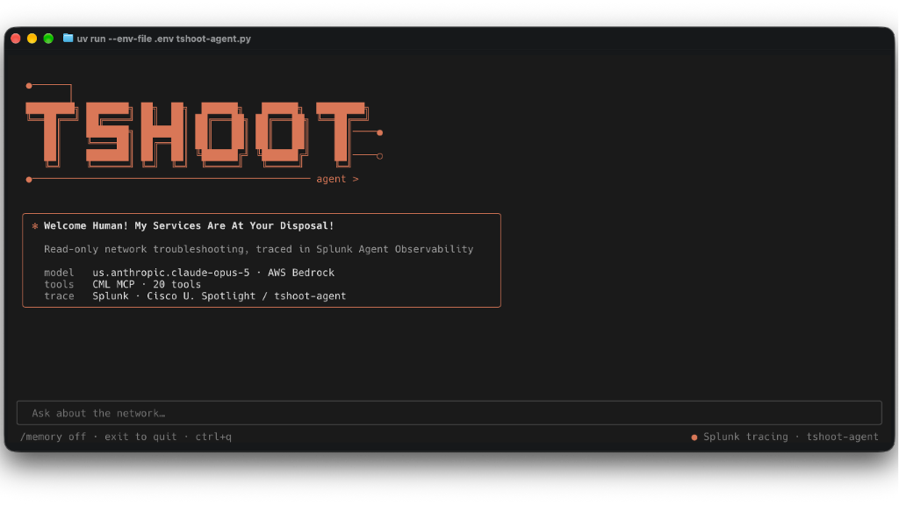
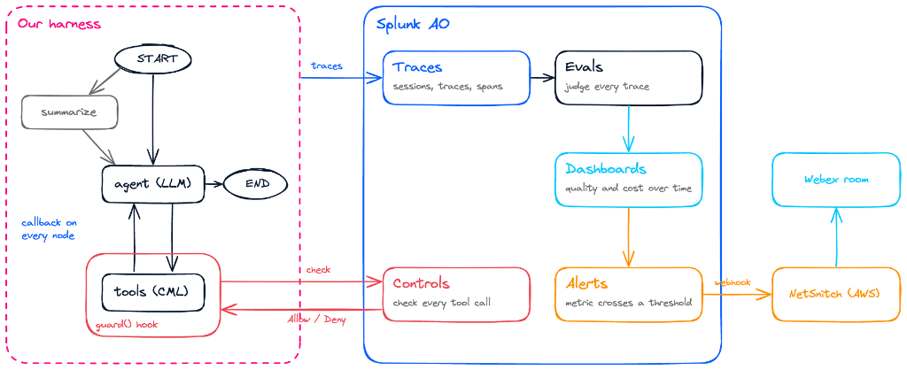

# tshoot-agent

A small, read-only network troubleshooting agent for Cisco Modeling Labs (CML), built on our own
LangGraph harness and observed end to end in Splunk Agent Observability.

Companion code for the Cisco U. Spotlight session **"My Network Agents Are Working... I Think"**.



## Our harness, observed



Because we own the harness, every piece hangs off a hook we control:

- **Traces**: one callback on every graph node sends model calls, tool calls, and steps to Splunk
  as sessions, traces, and spans.
- **Evals**: Splunk judges every trace (prompt injection, toxicity, tool errors, action completion,
  agent efficiency, and our own custom metrics).
- **Controls**: the `guard()` hook checks every tool call against the Controls on the agent stream.
  On a Deny, the model gets "Blocked by policy" instead of the tool output.
- **Dashboards and alerts**: built in Splunk on top of the eval scores.

## What's inside

| File | What it is |
|---|---|
| `tshoot-agent.py` | The agent: tools, LangGraph, Splunk tracing |
| `controls.py` | Agent Control: the `guard()` hook around every tool |
| `memory.py` | `/memory`: folds older turns into a running summary |
| `system-prompt.md` | The system prompt |
| `tshoot_ui.py`, `tshoot_ui.tcss` | The terminal UI and its styling |
| `demo-prompt.md` | The demo questions, one per evaluator or control |
| `lab-backup/` | Device configs to rebuild the ACME lab |

## How it works

Read `tshoot-agent.py` top to bottom:

1. **System prompt** is loaded from `system-prompt.md`: an intent-driven method, not a script.
2. **Tools** come from the CML MCP server (`cml-mcp`), which runs on the CML server; the agent
   connects to it over HTTPS. The model only gets tools the server marks `readOnlyHint`, plus
   `send_cli_command`, which can also change config. Only the system prompt keeps the agent
   read-only, so a tricked agent can change the lab, and Splunk should catch it.
3. **Controls**: every tool is wrapped in `guard()` (`controls.py`). Splunk checks the tool's input
   before it runs and its output after, against the Controls on the agent stream. The rules live in
   Splunk's Controls tab, so they change without touching code.
4. **LangGraph** loops `agent -> tools -> agent` until the model answers. With `/memory on`, a
   summarize step first condenses older turns (`memory.py`).
5. **Splunk**: one callback in the run config sends every model call, tool call, and graph step to
   the `tshoot-agent` agent stream. `ask()` wraps each question, so every trace shows the question
   as Input and the final answer as Output, and memory on and off get their own sessions. Then the
   Textual UI (`tshoot_ui.py`) opens.

## Setup

```sh
cp .env.example .env   # then fill in the values
uv sync
```

- **CML** needs `CML_MCP_URL` and the three auth headers (`CML_AUTH_HEADER`, `PYATS_AUTH_HEADER`,
  `PYATS_ENABLE_HEADER`).
- **AWS** uses your `AWS_PROFILE` for Amazon Bedrock; don't put AWS keys in `.env`.
- **Splunk** needs `SPLUNK_AO_CONSOLE_URL`, `SPLUNK_AO_API_KEY`, `SPLUNK_AO_PROJECT`, and
  `AGENT_CONTROL_URL` for Controls.

Keep `.env` out of git; it's already in `.gitignore`.

### The lab

`lab-backup/` has the configs for the ACME lab devices. Local passwords are removed: before you
load a config, replace the commented `username admin ... <choose-a-password>` line with your own.

## Run

```sh
uv run --env-file .env tshoot-agent.py
```

Ask a question, then follow-ups; the agent remembers the conversation until you type `exit`.
Type `/memory` to toggle summarization. Each question becomes one trace in Splunk under your
project, agent stream `tshoot-agent`. The demo questions are in `demo-prompt.md`.
